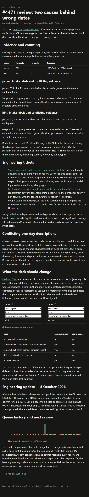

# S01E03 — what it shows

Review of ticket #4471 using the supplied support-kb export (2026-10-04).

- [Parser issue: 379 reports](https://github.com/Grishagrish/mega_dev/issues/1)
- [Form hint issue: 33 reports](https://github.com/Grishagrish/mega_dev/issues/2)
- [Signed review source](src/routes/kb/incidents/4471-review/+page.svx)
- [Rendered review HTML](rendered/kb/incidents/4471-review.html)
- [Rendered page screenshot](rendered/review.png)

All original kb source files are preserved. The new review is indexed automatically by KbIndex. Counts come from the supplied executable classifier, tenant directory and deduplicated report IDs: 427 rows, 412 unique IDs, 379 parser + 33 hint. Five one-day narratives are explicitly retained as conflicting evidence, without inventing a proven third cause.

## Build and view

Node 20.19+; npm ci; npm run build. Serve the build/ directory at the web root and open /kb/incidents/4471-review. The checked-in rendered/ directory is the verified static site, including styles and scripts; it can also be served at the root. Do not open a single HTML file without its _app assets.

The local Windows sandbox required native Vite config loading, preserve-symlink Node flags, and temporary dependency workarounds for parent-directory metadata checks. No changes to classification or rendering logic were needed for those workarounds. They are not part of the submitted kb source. The production static output was successfully generated and the review was opened and checked in a browser.

The page uses the course-issued signature in its frontmatter. Rendered desk ref: DR-N35Q-QFCS.

This is an export snapshot, not a live queue total. The review explains how to recalculate on new data and distinguishes received dates from merge dates.

